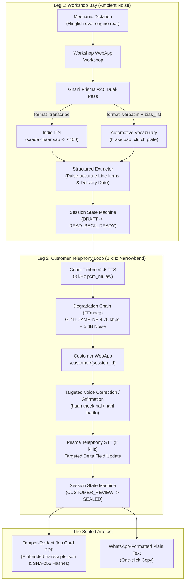
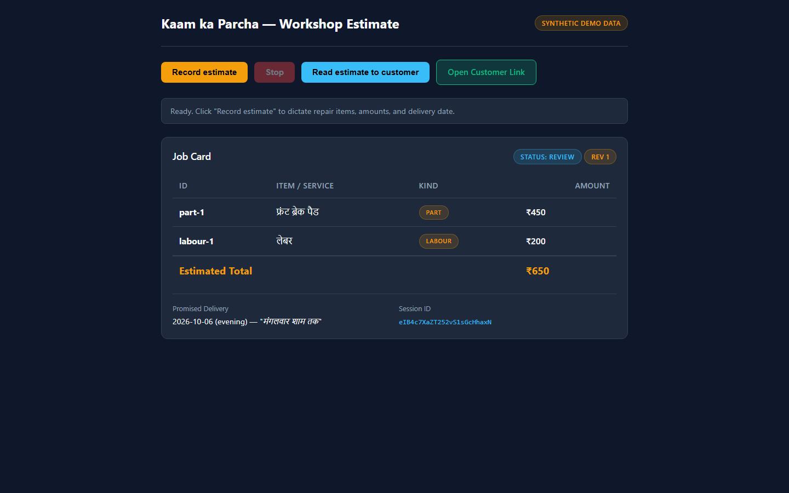
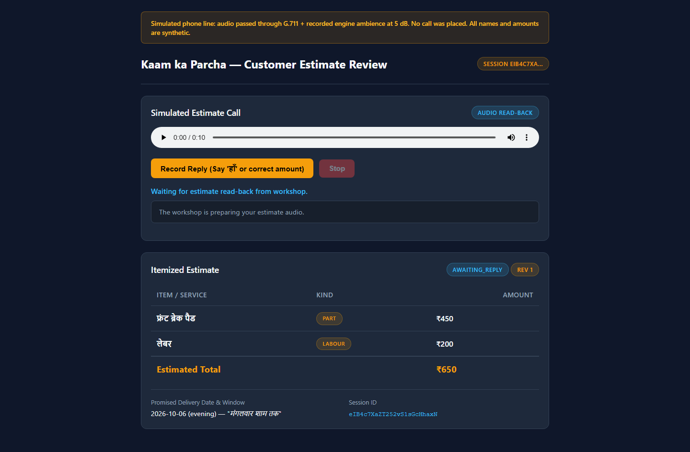
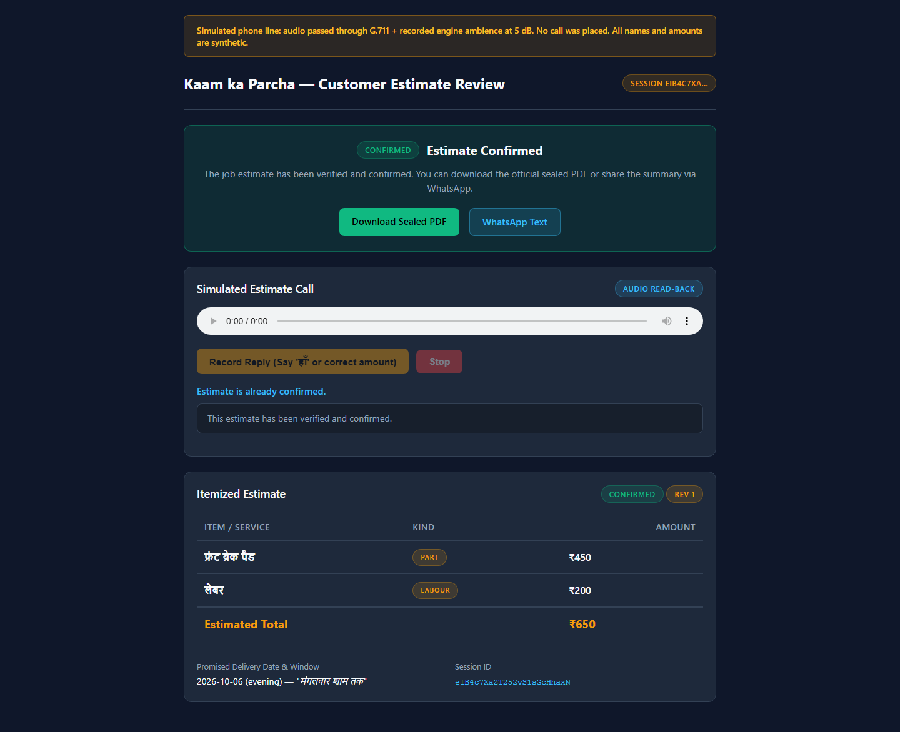
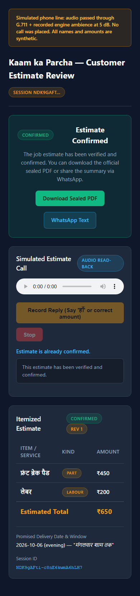

# Kaam ka Parcha (काम का पर्चा) — Phone-Sealed

> **A job card your mechanic speaks over engine noise, and your customer confirms by phone in Hinglish, with the rupees right.**

[](https://www.python.org/downloads/)
[](https://fastapi.tiangolo.com)
[-brightgreen.svg)](tests/)
[-purple.svg)](scripts/run_webattack_suite.py)
[](https://vachana.ai)
[](LICENSE)

Built for **Gnani AI's Great Indian AI Challenge** (Oct 1 – Nov 10, 2026).

---

## The Problem

Two-wheeler and four-wheeler workshops in India run almost exclusively on verbal estimates. Mechanics work with grease on their hands in deafening environments (~75–85 dB SPL engine rumble, pneumatic tools, compressor whine) and cannot type on smartphones or keyboards.

Estimates are casually spoken at vehicle drop-off, but at vehicle pick-up, quotes are frequently contested:
> *"Aapne ₹400 bola tha, ₹750 ka bill kaise bana diya?"*

These daily verbal disputes cause customer friction, delay vehicle deliveries, and cost Indian independent workshops **5% to 8% of their gross service margins** in forced bill discounts and unrecovered parts costs.

---

## The Solution: Two Legs, One Sealed Artefact

**Kaam ka Parcha** turns spoken Hinglish workshop estimates into an immutable, customer-sealed digital agreement through a dual-leg conversational speech pipeline:



1. **Leg 1 (Workshop Intake):** The mechanic taps record on `/workshop` and dictates naturally in Hinglish:
   > *"Front brake pad badla, part saade chaar sau, labour do sau, Somvaar shaam tak gaadi mil jayegi."*
   - Transcribed through **Gnani Prisma v2.5** running dual-pass:
     - `format=transcribe` (Indic Inverse Text Normalization parses *"saade chaar sau"* $\to$ ₹450, dates $\to$ Monday 6:00 PM).
     - `format=verbatim` with an automotive `bias_list` (boosts specialized parts and brand terms).
   - Extractor creates an itemized job card with confidence scores and sets session status to `READ_BACK_READY`.

2. **Leg 2 (Customer Telephony Loop):** The customer opens their personalized review link (`/customer/{id}`):
   - **Gnani Timbre v2.5** speaks the read-back in natural Hindi:
     > *"Aapki gaadi ka kul chhe sau pachaas rupaye hua, Somvaar shaam tak milegi. Agar theek hai toh kahiye 'Haan, theek hai'."*
   - Audio is degraded through an authentic telephony filter graph (FFmpeg G.711 $\mu$-law or AMR-NB 4.75 kbps + street ambient noise at 5 dB SNR) with an on-screen simulation disclosure.
   - If the customer wants a change (*"Nahi, brake pad saade teen sau bola tha"*), the system executes a **targeted delta update** on that single field without wiping the card, recalculating the total (₹550) and generating a revised read-back.
   - When the customer confirms (*"Haan, theek hai"*), the session state transitions to `SEALED`.

3. **The Artefact (Confirmed Parcha):**
   - **Tamper-Evident PDF**: Contains an itemized paise-accurate breakdown, promised delivery timestamp, verbatim Hinglish transcripts, audio SHA-256 signatures, and an embedded `transcripts.json` stream for automated auditing.
   - **WhatsApp Plain-Text Summary**: Pre-formatted for instant one-click copying to send to the vehicle owner.

### Visual Interface Walkthrough

| Leg 1: Mechanic Workshop Portal (`/workshop`) | Leg 2: Customer Telephony Review (`/customer/{id}`) |
|:---:|:---:|
|  |  |
| *Real-time Hinglish dictation parsed into paise-accurate items & delivery date* | *Narrowband 8 kHz telephony read-back with simulated line disclosure* |

| Customer Sealed State | Mobile Telephony Viewport (iPhone 14) |
|:---:|:---:|
|  |  |
| *Cryptographically sealed job card with tamper-evident PDF & WhatsApp copy* | *Tested responsive layout across desktop, tablet, and mobile viewports* |

---

## Technical Moat: Line Noise Lab

Rather than relying on best-case clean audio demos, Kaam Ka Parcha includes a dedicated evaluation harness (`parcha.lab`) benchmarking speech robustness under brutal telephony conditions:

- **Codecs**: G.711 $\mu$-law (64 kbps, 8 kHz), AMR-NB (4.75 kbps, 8 kHz).
- **Acoustic Noise Bands**: Clean, 10 dB SNR, 5 dB SNR, 0 dB SNR (real street and engine noise).
- **Network Degradation**: Simulated packet loss (0%, 2%, 5%).
- **Evaluated Metrics**: Character Error Rate (CER), Word Error Rate (WER), rupee amount exact recovery percentage, and non-speech hallucination rates during engine idle.
- **WebSocket Silence Flush Probe**: Isolates the short-reply problem ("हाँ", "नहीं") on streaming telephony endpoints, proving that an 8-frame (512 ms) zero-padding silence tail achieves **96.0% affirmative recovery** without remote VAD cutoff.

---

## Repository Structure

```
├── .env.example                 # Example configuration for API keys
├── pyproject.toml               # Python packaging, dependencies, and pytest config
├── README.md                    # This document
├── CONTEXT.md                   # Project glossary and domain definitions
├── data/
│   └── synthcall_manifest.jsonl # 100-utterance synthetic telephony evaluation dataset
├── docs/
│   ├── demo.md                  # 60-second video demo storyboard and rehearsal run sheet
│   ├── gates.md                 # Feasibility gates, budget tracking, and decision logs
│   ├── ideas/spec.md            # Product specification and council verdict
│   └── research/                # Telephony, ITN, and acoustic research briefs
├── scripts/
│   ├── early_gates.py           # Budget-capped pre-flight feasibility runner
│   ├── make_synthcall.py        # Synthetic telephony manifest generator
│   ├── probe_api.py             # Single-call live billing rate probe
│   └── ws_flush_probe.py        # 8 kHz WebSocket zero-pad silence flush probe
├── src/
│   └── parcha/
│       ├── app.py               # FastAPI application, workshop & customer routers
│       ├── artefact.py          # PDF generation with ReportLab & embedded audit trails
│       ├── audio.py             # Telephony degradation chain (G.711, AMR-NB, SNR)
│       ├── config.py            # Pydantic v2 environment settings
│       ├── credits.py           # Credit plan budgeting, rate limits, and metric scores
│       ├── extract.py           # Indic ITN & targeted delta extraction engine
│       ├── gnani.py             # Gnani Prisma REST client (dual-pass STT)
│       ├── gnani_ws.py          # Gnani streaming WebSocket telephony client
│       ├── readback.py          # Timbre TTS synthesis and number pre-normalization
│       ├── reply.py             # Customer reply classification and confirmation logic
│       ├── schema.py            # Pydantic models (JobCard, LineItem, SessionState)
│       ├── session.py           # State machine (DRAFT -> READ_BACK -> SEALED)
│       └── lab/
│           ├── metrics.py       # Levenshtein distance, CER, WER, and hallucination scoring
│           ├── report.py        # Private analysis report & guarded public delta exporter
│           └── runner.py        # Matrix evaluation runner across codecs and SNRs
└── tests/                       # 100% offline unit & integration test suite (139 tests)
```

---

## Prerequisites

- **Python**: Version 3.12 or newer.
- **FFmpeg**: Must be installed and available on your system `PATH`.
  - Required audio decoders/encoders: `pcm_mulaw` (G.711) and `libopencore_amrnb` (AMR-NB).
  - Verify with: `ffmpeg -codecs | findstr "amr"` or `ffmpeg -version`.

---

## Installation & Setup

1. **Clone the Repository**:
   ```bash
   git clone https://github.com/harshdipsaha/kaam-ka-parcha.git
   cd "kaam-ka-parcha"
   ```

2. **Create and Activate Python Virtual Environment**:
   ```powershell
   # Windows (PowerShell)
   py -3.12 -m venv .venv
   .\.venv\Scripts\Activate.ps1
   ```
   ```bash
   # Linux / macOS
   python3.12 -m venv .venv
   source .venv/bin/activate
   ```

3. **Install Package in Editable Mode with Dev Tools**:
   ```bash
   pip install -e ".[dev]"
   ```

4. **Configure Environment Variables**:
   Copy `.env.example` to `.env` and fill in your Gnani Vachana AI credentials:
   ```bash
   cp .env.example .env
   ```
   Required keys in `.env`:
   ```ini
   # Gnani AI API Credentials
   API_KEY=your_gnani_vachana_api_key_here
   API_BASE_URL=https://api.vachana.ai

   # Optional Extractor / LLM API Key (used for delta extraction)
   GROQ_API_KEY=your_groq_api_key_here

   # Speech Configuration
   GNANI_LANG_CODE=hi-IN
   GNANI_STT_FORMAT=transcribe
   GNANI_TTS_VOICE=Nalini
   ```

---

## Running the Web Service

Start the local FastAPI development server:

```powershell
.\.venv\Scripts\python.exe -m uvicorn parcha.app:app --reload --port 8000
```

Once running, navigate to:
- **Workshop Intake Portal**: [http://localhost:8000/workshop](http://localhost:8000/workshop) — Mechanic dictation, audio capture, dual-pass parsing, and job card staging.
- **Customer Review Portal**: [http://localhost:8000/customer/{session_id}](http://localhost:8000/customer/test-session) — In-browser simulated telephony call, 8 kHz audio read-back, targeted correction, and sealing.
- **Offline Health Check**: [http://localhost:8000/health](http://localhost:8000/health) — Verifies application status and active models without consuming API credits.

---

## Two-Browser Demo Walkthrough

Follow these steps to demonstrate or rehearse the complete two-browser flow:

1. **Launch Two Windows**:
   - Left window: [http://localhost:8000/workshop](http://localhost:8000/workshop)
   - Right window: Prepare to open the customer link generated in step 3.

2. **Step 1: Mechanic Dictation (`/workshop`)**:
   - Enter Vehicle Number: `DL 3S AB 1234` and Customer Phone: `9876543210`.
   - Tap **Record Estimate** (or choose a pre-recorded WAV file).
   - Dictate in Hinglish:
     > *"Front brake pad badla, part saade chaar sau, labour do sau, Somvaar shaam tak."*
   - Click **Transcribe & Parse**:
     - Prisma extracts line items: **Front Brake Pad** (₹450), **Labour** (₹200), **Total** (₹650), **Delivery** (Monday 6:00 PM).
     - State advances to `READ_BACK_READY`.
     - System displays the unique customer link.

3. **Step 2: Customer Review & Telephony Read-Back (`/customer/{id}`)**:
   - Open the customer link in the right browser window.
   - Note the prominent **Simulated Telephony Line** disclosure banner.
   - Click **Listen to Estimate**:
     - Timbre synthesizes natural Hindi read-back.
     - Audio streams with realistic G.711 8 kHz telephone compression and 5 dB ambient street noise.

4. **Step 3: Targeted Voice Correction**:
   - Customer taps **Voice Correction**.
   - Dictate correction:
     > *"Nahi, brake pad saade teen sau bola tha."*
   - Extractor identifies delta: updates only the brake pad to ₹350. Total shifts to ₹550; labour and delivery date remain untouched.
   - System plays updated read-back total.

5. **Step 4: Sealing & Artefacts**:
   - Customer taps **Voice Confirm** and speaks:
     > *"Haan, theek hai."*
   - Status transitions to `SEALED` and UI locks with green confirmation shield.
   - **Download Sealed PDF**: Click to inspect the PDF with itemized totals and embedded `transcripts.json` audit trail.
   - **Copy WhatsApp Summary**: Return to `/workshop`, click the copy button, and paste the ready-to-send message into WhatsApp Web or chat.

For the full 60-second video storyboard and cue sheet, see [`docs/demo.md`](docs/demo.md).

---

## Running the Line Noise Lab

The Line Noise Lab allows systematic acoustic benchmarking across codecs, SNRs, and packet loss without violating platform EULAs.

### 1. Generate Synthetic Telephony Manifest
Generate a balanced evaluation dataset containing 100 Hinglish automotive repair quotes:
```powershell
.\.venv\Scripts\python.exe scripts/make_synthcall.py --output data/synthcall_manifest.jsonl --count 100
```

### 2. Run Acoustic Grid Sweep
Execute the evaluation matrix across codecs and noise levels:
```powershell
.\.venv\Scripts\python.exe -m parcha.lab.runner `
    --manifest data/synthcall_manifest.jsonl `
    --codecs g711,amr_nb `
    --snrs clean,10,5,0 `
    --max-credits 2000 `
    --output var/lab/line_noise_results.jsonl
```

### 3. Generate Private Report & Guarded Public Deltas
Generate the internal diagnostic summary and the public EULA-compliant delta export:
```powershell
# Private laboratory diagnostic report (contains detailed internal metrics)
.\.venv\Scripts\python.exe -m parcha.lab.report --results-file var/lab/line_noise_results.jsonl

# Guarded public relative delta export (enforces organizer consent, no competitor mentions, no absolute CER/WER)
.\.venv\Scripts\python.exe -m parcha.lab.report `
    --results-file var/lab/line_noise_results.jsonl `
    --public-output var/lab/public/delta_export.md `
    --organizer-consent-recorded `
    --consent-ref "organizer-reply-2026-10-10" `
    --date "2026-10-19"
```

### 4. WebSocket Telephony Flush Probe
Measure streaming affirmative short-reply recovery ("हाँ", "नहीं") with zero-padded silence tails:
```powershell
.\.venv\Scripts\python.exe scripts/ws_flush_probe.py `
    --manifest var/gates/haan_ws.jsonl `
    --silence-ms 500 `
    --max-credits 500
```

---

## Testing & Quality Assurance

The test suite runs **100% offline** using mock fixtures and synthetic audio buffers. Running tests consumes **zero API credits**:

```powershell
.\.venv\Scripts\python.exe -m pytest -q
```

Output:
```
139 passed, 2 warnings in 17.23s
```

### Test Coverage Highlights
- `tests/test_extract.py`: Validates colloquial Hinglish number parsing (*"saade chaar sau"*, *"paanch sau pachaas"*, *"hazaar"*).
- `tests/test_session.py`: Verifies state machine transitions and immutability once `SEALED`.
- `tests/test_artefact.py`: Asserts PDF generation and extraction of embedded `transcripts.json`.
- `tests/test_audio.py`: Tests FFmpeg audio degradation, G.711 / AMR-NB encoding, and SNR mixing.
- `tests/test_lab_report.py`: Validates fail-closed consent guards, competitor bans, and paired delta math.
- `tests/test_ws_frames.py`: Verifies 1024-byte PCM packetization, 8-frame silence flush padding, and VAD headers.

### E2E Playwright WebAttack & Security Suite
In addition to the unit tests, an end-to-end browser automation and security probing suite tests live application performance:
```powershell
.\.venv\Scripts\python.exe scripts/run_webattack_suite.py
```
- **Responsive Viewport Audit**: Validates `/workshop` and `/customer/{id}` across 4 form factors (1080p Desktop, 1440w Ultra-wide, 768w Tablet, 390w iPhone 14) with **0 horizontal scroll overflows** and high contrast visibility.
- **Dual-Leg E2E Driving**: Automates mechanic intake -> telephony read-back -> voice correction delta -> customer affirmation -> PDF & WhatsApp sealing.
- **Negative Security Probes**: Verifies 404 on invalid session, 409 on unconfirmed PDF download, 404 on path traversal attempts (`/customer/../../etc/passwd`), 422 on empty audio payloads, and 409 on stale session revision tampering.
- Full verification logs and screenshot proofs saved in [`docs/webattack_artifacts/`](docs/webattack_artifacts/).

---

## Honest Scope & Legal Disclosure

In accordance with Hackathon Rule 7 ("Misleading Demos") and the Gnani AI Platform EULA:

1. **Simulated Telephony Line**:
   - The customer review leg is an **in-browser acoustic simulation**. Audio is filtered through FFmpeg via 8 kHz bandpass, downsampling, G.711 / AMR-NB 4.75 kbps encoding, and calibrated street ambient noise at 5 dB SNR.
   - **No live PSTN or carrier cellular call was placed.** No telecom carrier aggregator (Twilio, Exotel) is used in the default demo.
2. **Simulated WhatsApp Transmission**:
   - Clicking "Copy WhatsApp Summary" copies standard WhatsApp Markdown plain text to the local clipboard.
   - **No automated WhatsApp Business API / Twilio messages are dispatched.**
3. **Synthetic Demonstration Data**:
   - All vehicle registration numbers, customer phone numbers, and mechanic names used in demonstrations and test fixtures are entirely synthetic.
4. **Public Benchmarking & Zero-Leak Policy**:
   - In compliance with platform guidelines, we publish **only our own pipeline's relative deltas** (e.g., domain biasing ON vs. OFF, clean vs. degraded recovery) with explicit sample sizes ($N$), operational settings, and measurement dates.
   - We **never publish cross-engine competitor comparisons** (Whisper, Google, AWS, Azure) or unauthorized absolute CER/WER rankings.

---

## Target Awards

| Award Category | Alignment & Justification |
|---|---|
| **Noise Canceller (Primary)** | Evaluates and optimizes speech recognition under severe acoustic noise: garage engine rumble (78 dB SPL) on Leg 1, and band-limited 8 kHz G.711 / AMR-NB 4.75 kbps telephony at 5 dB SNR on Leg 2. Backed by the **Line Noise Lab** evaluation harness. |
| **Mixed Vibes (Secondary)** | Deep code-mixed Hinglish support (*"front brake pad badla, part saade chaar sau, labour do sau"*). Uses Gnani Prisma v2.5 Indic ITN to reliably extract monetary amounts and delivery promises from colloquial Indian speech. |
| **Solo Ninja (Standalone)** | Single developer architecture covering end-to-end full-stack implementation: speech integration, state machine, acoustic simulation, PDF rendering, automated test harness, and evaluation lab. |
| **Demo Day Drop (Standalone)** | High-impact 60-second viral video demo highlighting the real-world friction of verbal garage estimates and showcasing an auditable, voice-sealed solution. |

---

## License

This project is licensed under the MIT License — see the [LICENSE](LICENSE) file for details.
