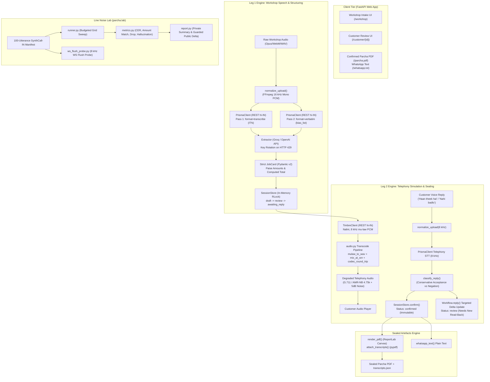

# AI-DLC Inception: System Architecture (Reconciled)

**Project:** Kaam ka Parcha (Phone-Sealed)  
**Status:** Inception Baseline — Reconciled & Locked  
**Baseline Date:** 2026-10-04 (Reconciled 2026-10-05)  

---

## 1. System Overview

---

## 2. Technology Stack & API Choices

| Layer | Technology | Justification |
|---|---|---|
| **Speech-to-Text (STT)** | **Gnani Prisma v2.5** (`api.vachana.ai/stt/v3`) | Native Indic ITN for currency/dates; 8 kHz telephony optimization; `bias_list` vocabulary boosting. |
| **Streaming Telephony STT** | **Gnani WebSocket STT** (`api.vachana.ai/stt/v3/stream`) | Realtime streaming evaluation with telephony VAD headers and 500 ms zero-padding silence tail. |
| **Text-to-Speech (TTS)** | **Gnani Timbre v2.5** (`api.vachana.ai/api/v1/tts/inference`) | High-fidelity Indic voices (Nalini), native 8 kHz $\mu$-law output matching cellular channels. |
| **LLM Extractor** | **Groq OpenAI-Compatible API** (`llama-3.3-70b-versatile`) | Fast, structured JSON extraction with multi-key pool rotation on HTTP 429. |
| **Audio Processing** | **FFmpeg 9.0 (Subprocess Pipes) + NumPy** | Codec transcoding (AMR-NB 4.75 kbps via `libopencore_amrnb`, G.711 via `pcm_mulaw`), calibrated SNR mixing, and frame erasure. |
| **Backend & Routing** | **Python 3.12 / FastAPI / Uvicorn** | High-performance asynchronous HTTP routing, dependency injection (`AppServices`), Jinja2 templating, and static asset delivery. |
| **Validation & State** | **Pydantic v2 + Threading RLock** | Strict frozen data models (`extra="forbid"`) and thread-safe revisioned optimistic session store. |
| **Document Generation** | **ReportLab 4.0 + PyPDF 4.0** | Produces customer-facing tamper-evident PDF with cryptographically embedded `transcripts.json` audit trail. |
| **Evaluation Spine** | **Custom Levenshtein Dynamic Program + NumPy** | Character Error Rate (CER), numeric amount match, short-reply drop, and non-speech hallucination counting. |

---

## 3. Data Flow & Security
* **Secrets Management:** `API_KEY` and `GROQ_API_KEY` are read from `.env` and kept out of version control. Dataclass fields use `field(repr=False)` to prevent secret leakage in logs.
* **Synthetic PII:** All customer phone numbers, names, and vehicle registration plates are synthetically generated.
* **Storage Isolation:** Session audio and generated artifacts are stored under ignored `var/` or in-memory, never committed.
* **Offline Testing:** 100% of the unit test suite runs offline with mock transports and in-memory audio fixtures, consuming 0 Gnani credits.
